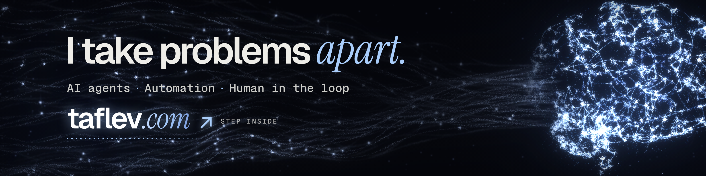

  

# Hi, I'm Igal

**I put AI to work, and I keep it accountable.**

I take problems apart: see it, doubt it, split it, measure it, kill most of the ideas, prove the rest. Then I hand the repetitive parts to AI and keep a human on the decisions that matter.

Based in Montréal. I started in law (LL.B), moved through IT operations and project management, and today I design agentic systems, automation and AI-assisted tooling at global scale.

## What I do

- **AI solutions and automation.** Turning slow, manual processes into systems that run on their own, with AI where it earns its place and clear controls around it.
- **Process improvement.** Lean and data-driven, with a Six Sigma Green Belt from McGill. Measure first, then fix the process, not only the symptom.
- **Building my own products.** Real tools for real problems, from AI agents to 3D-printed hardware, built and shipped with a studio of AI agents that I orchestrate.

## How I build with AI

- **Multi-agent orchestration.** Each agent owns a narrow job, works with least privilege, and runs in build, review and verify loops.
- **Human in the loop.** AI watches the system; a person gets the decisions that matter and approves every release.
- **Data in, patterns out.** AI cross-checks real records and flags what doesn't add up, so the decisions hold up.

## Selected results

- **98% less audit time.** A global audit cut from 3 hours to under 3 minutes.
- **90%+ less manual work.** An equipment-returns platform for a 7,000+ person company, designed and built single-handedly.
- **20,000+ devices a month.** Reconciled by an AI-assisted tool that cross-checks asset records and flags discrepancies.

## Featured projects

### Panoui!

Four parking signs on one pole, one plain answer. Panoui! shows where you can park right now, on iPhone and Android.

- **Every curb, colour-coded live.** Free, paid with the price, or no parking, built from the city's official open data. Tap a spot for a plain answer like "Free until 8 AM".
- **Built by a studio of AI agents.** About 35 specialised agents across 8 disciplines and 7 work lanes design, build, test and ship it.
- **One human at the gate.** Every change goes through build, review and verify, and nothing ships until I approve it.
- **Guardrails by design.** No agent approves its own work, security gates run on every change, and agents get only the access their job needs.

### BrainOS

A digital twin of how I think, learned from my real conversations rather than questionnaires.

- **Learns from evidence.** It reads my Claude Code conversations, scrubs secrets before storing anything, and builds a versioned profile of how I reason and decide.
- **Writes its own skills.** Observations become a map of areas and skills, and each skill becomes a reusable SKILL.md for my agents.
- **Talks like me.** An agent built on the Claude Agent SDK can chat as me or draft the reply I would send.
- **Measured honestly.** Every 10th exchange is held out, and a judge model scores the twin's predictions against my real replies.

### AiQ

A vetted knowledge base of know-how for building AI agents, served to my other agents over MCP.

- **Cheap triage.** It follows creators and feeds, and a small model turns each item into a card for a fraction of a cent.
- **Two human gates.** I approve what gets processed, and again what gets served. Nothing reaches an agent without my yes.
- **Grounded.** Every insight keeps a verbatim quote and a timestamp from its source, and every guideline says when not to apply it.
- **Budget-capped.** Every model call is checked against a monthly cap before it runs.

### Sidekick

In a video meeting your eyes belong on the camera, not on your notes. Sidekick turns the tablet next to my webcam into a teleprompter that listens.

- **Reads the room.** It hears both sides, attributes each line to a participant, and reads each person's tone.
- **Writes my next line.** One to three short sentences, written for the ear and updated in about three seconds, with alternatives.
- **Paced for reading aloud.** The words light up as I speak, and a new suggestion never pulls away the sentence I'm in the middle of.
- **Debrief included.** When the meeting ends, it writes the key points, decisions, action items and a follow-up message.

## What I'm building

| Project | What it is |
| --- | --- |
| [**Panoui!**](https://github.com/Taflynx/panoui.com) | Every curb, decoded live: a parking app for iPhone and Android, built by a studio of ~35 specialised AI agents with one human approval gate. My own initiative. |
| [**BrainOS**](https://github.com/Taflynx/brainos-showcase) | A digital twin of how I think: learns from my real Claude Code conversations, writes agent skills from the evidence, and is graded against my actual replies. |
| [**AiQ**](https://github.com/Taflynx/aiq-showcase) | Signal from the AI noise: a vetted knowledge base of agent-building know-how, with cheap triage, two human approval gates, and delivery to my agents over MCP. |
| [**Sidekick**](https://github.com/Taflynx/sidekick-showcase) | Your next line, under the camera: a tablet next to the webcam listens to the meeting, reads each participant's tone, and writes what to say in short sentences paced for reading aloud. |
| [**Lastdrop**](https://github.com/Taflynx/lastdrop) | Know before the last shot: a low-water alert for an espresso machine, with a capacitive sensor outside the tank, ESPHome and Home Assistant, in a parametric 3D-printed housing with an inlaid logo. |
| [**Edik**](https://github.com/Taflynx/edik-showcase) | Patient tech support for my parents: a Telegram agent in Russian, with voice and annotated screenshots, where every sensitive answer goes through me. |
| [**CC Pulse**](https://github.com/Taflynx/ccpulse) | Understand, learn from and forecast Claude Code usage: pace against limits, forecasts, anomaly alerts and a local dashboard. |
| [**CC Pulse TV**](https://github.com/Taflynx/ccpulse-tv) | Claude on your desk: Claude Code usage, a pixel critter and a clock with weather on a small desk display. |
| [**Dayline**](https://github.com/Taflynx/dayline) | Every time zone you care about on one painted timeline. A single-file WebGL2 web app. |
| [**Dayscape**](https://github.com/Taflynx/dayscape) | A browser home page of movable widgets over a living landscape that follows the real time and weather. |

Some of my most significant work is not here: systems built for an employer are proprietary, and some products are private. I'm glad to walk through the architecture and the agent setup in a conversation.

**What I work with:** Claude Code, multi-agent workflows, TypeScript, Cloudflare, Google Apps Script and Google Workspace, web apps (PWA). Off the screen: ESPHome, Home Assistant, CadQuery and 3D printing.

## Find me

Open to AI solutions and problem-solving roles, advisory work, and conversations about Panoui!
